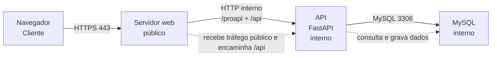

# Arquitetura de produção (proposta)

## 1. Arquitetura de produção

Para testar no Mermaid Live, cole apenas o conteúdo do bloco, começando em `flowchart LR`.

Linhas por caixa:
- Navegador: roda na máquina do usuário; não expõe porta de servidor; recebe tráfego público via HTTPS na 443.
- Servidor web: roda em uma máquina de aplicação/proxy; atende na porta 443; recebe tráfego público e encaminha `/api` para a API interna na 8000.
- API: roda em uma máquina interna da aplicação; atende na porta 8000; recebe apenas tráfego interno do servidor web e não é pública diretamente.
- Banco: roda em máquina interna do banco; atende na porta 3306; recebe apenas tráfego interno da API.
- Observação: "mesma máquina do servidor web ou máquina interna de app" é uma proposta, porque no código atual há Vite e FastAPI em portas diferentes e o projeto ainda usa fallback em SQLite; o item "mesma máquina ou máquina separada" é ? no contexto atual.

## 2. Desenvolvimento e produção

| Componente | Desenvolvimento hoje | Produção (proposta) |
|---|---|---|
| API | FastAPI em `http://127.0.0.1:8000` e executada com `fastapi dev main.py` | API interna, escutando em `0.0.0.0:8000` ou host interno, acessível apenas pelo servidor web em `/api` |
| Tela | React/Vite em `http://127.0.0.1:5173` | Tela servida pela mesma origem do domínio, via HTTPS na 443, sem necessidade de CORS entre tela e API |
| Banco | Hoje há fallback para SQLite e uso opcional de MySQL via variáveis de ambiente | MySQL interno em 3306, acessível somente pela API |
| `.env` | `backend/.env` local com `FRONTEND_ORIGEM`, `MYSQL_*` e demais variáveis | Variáveis de ambiente do ambiente de produção; sem arquivo de configuração no repositório |
| CORS | Habilitado para origens locais em `backend/configuracao.py` | Não é necessário entre tela e API quando a tela e a API ficam na mesma origem; se houver separação, manter política restrita |

Observações:
- A arquitetura do projeto atual é de tela e API em portas diferentes, com CORS liberado para o front local.
- A arquitetura de produção proposta mantém a mesma origem para tela e API, seguindo a exigência do projeto e não inventando CORS entre elas.
- O item "mesma origem" é a proposta de produção; o código atual não mostra isso em execução real, então é um ajuste de arquitetura e não uma descrição já publicada.

## 3. O caminho do login

1. O usuário clica em "Entrar" na tela do navegador.  
   Máquina: usuário.

2. O navegador envia uma requisição `POST` para o endpoint de login, normalmente pela origem do domínio e pelo servidor web público.  
   Máquina: usuário envia; servidor web recebe.

3. O servidor web encaminha a requisição para a API interna em `/api/login` (ou para a rota equivalente) na porta 8000.  
   Máquina: servidor.

4. A API em FastAPI recebe a requisição e chama a rota de usuários, que valida e autentica as credenciais.  
   Máquina: servidor.

5. O serviço de usuário verifica o e-mail e compara a senha com o hash armazenado.  
   Máquina: servidor.

6. Se a credencial for válida, a API gera o token JWT e retorna `access_token` + dados do usuário.  
   Máquina: servidor.

7. O navegador recebe a resposta JSON e guarda o token no `localStorage`.  
   Máquina: usuário.

8. Nas próximas requisições protegidas, o navegador envia o token no header `Authorization: Bearer ...` e a API valida o token antes de responder.  
   Máquina: usuário envia; servidor valida.

Esse fluxo já aparece no projeto: a rota de login em `backend/rotas/usuarios.py`, a autenticação em `backend/servicos/usuario.py` e o armazenamento no frontend em `frontend/src/Aplicacao.jsx`.

## 4. O que está chumbado

Esses são os pontos de `localhost` e `127.0.0.1` que aparecem no código e nos documentos de execução local. Não são todos erros; são referências de desenvolvimento, não de produção.

- `backend/configuracao.py:11` — servidor: `http://127.0.0.1:5173,http://localhost:5173` em `ORIGENS_FRONTEND`.  
  Uso: lista de origens permitidas pelo CORS em desenvolvimento local, para o frontend rodar em porta do Vite.

- `backend/configuracao.py:14` — servidor: `ORIGEM_FRONTEND = ... "http://127.0.0.1:5173"`.  
  Uso: origem padrão do frontend em desenvolvimento; é um valor do servidor para aceitar requisições locais.

- `backend/configuracao.py:17` — servidor: `MYSQL_HOST = os.getenv("MYSQL_HOST") or "localhost"`.  
  Uso: fallback local para o banco; mostra que o projeto ainda assume MySQL e/ou SQLite em máquina local.

- `frontend/src/Aplicacao.jsx:8` — navegador: `const enderecoApi = "http://127.0.0.1:8000";`.  
  Uso: endereço fixo da API usado pelo frontend em desenvolvimento; o navegador chama diretamente esse host.

- `README.md:28` — documentação: instrução para abrir `backend/.env` e ajustar `FRONTEND_ORIGEM` com `http://127.0.0.1:5173`.  
  Uso: guia de execução local, não configuração de produção.

- `README.md:34` — documentação: link para `http://127.0.0.1:8000/docs`.  
  Uso: acessar a documentação interativa da API localmente, em ambiente de desenvolvimento.

- `README.md:52` — documentação: `npm run dev -- --host 127.0.0.1`.  
  Uso: rodar o frontend em host local para testar no navegador.

- `README.md:55` — documentação: `http://127.0.0.1:5173`.  
  Uso: endereço do frontend em execução local, não público.

Não incluí `backend/.env` por instrução, e também não escrevi nenhum valor real de senha, token, chave ou segredo. Em produção, esses endereços locais devem sair do código e ser substituídos por nomes de domínio e portas internas apropriadas, sem expor a API diretamente ao navegador.

Perguntas para apresentação:
1. No seu entendimento, a melhor arquitetura de produção é manter tela e API na mesma origem ou separar domínio e rota pública para a interface?
2. O projeto atual tem MySQL opcional e SQLite como fallback; quando você decidiria que a produção precisa migrar de forma obrigatória para MySQL real?
3. O fluxo de login atual usa JWT em `localStorage`; você quer manter essa estratégia exatamente como está ou revisar a autenticação antes de fechar a proposta de produção?
